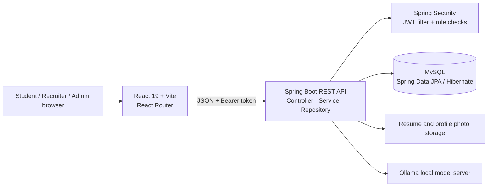
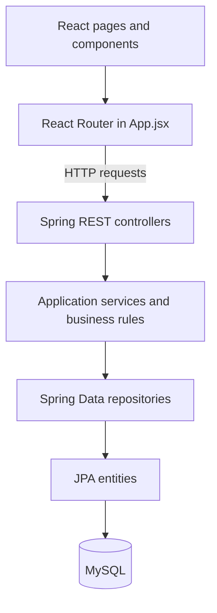
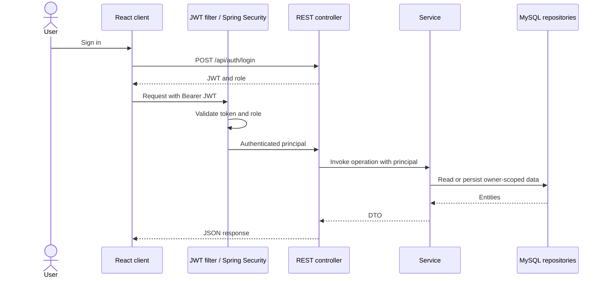
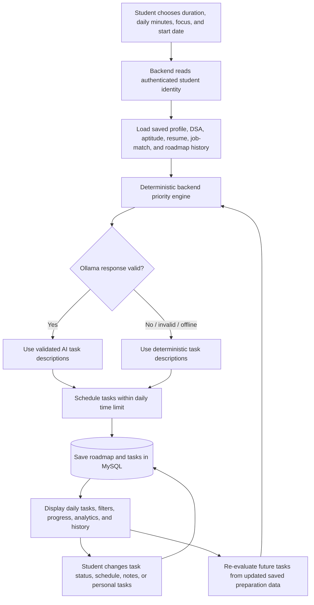
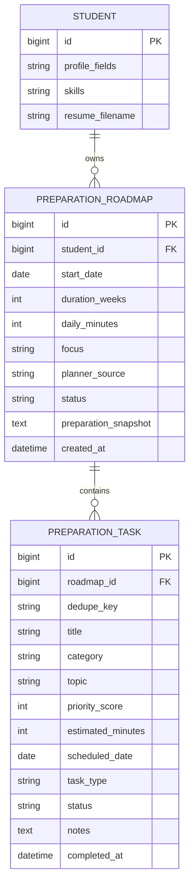

# Campus Placement Portal - Architecture

This page documents the architecture present in this repository. It describes the React/Vite client, Spring Boot API, MySQL persistence, authentication, and the personalized preparation roadmap.

## System at a glance

The frontend lives in `placement-portal/`. The Spring Boot application lives in `placement-portal-bk/placement-portal-bk/`. The frontend calls the API over HTTP; student API access is protected by JWT authentication and the `STUDENT` role.

## Main application layers

### Frontend

- **Framework:** React 19, Vite, and React Router.
- **Routes and page composition:** `placement-portal/src/App.jsx`.
- **Student dashboard and readiness:** `Student/StudentDashboard.jsx` and `Student/Functions/placementReadiness.js`.
- **Student preparation modules:** profile, DSA tracker, aptitude practice, job matches, resume analysis, and preparation roadmap under `Student/`.
- **Recruiter and administrator areas:** `RecruiterDashboard/`, `Recuriter-ManageJobs/`, `RecuriterApplication/`, `Shortlisted/`, and `AdminDashboard/`.
- **API calls:** pages use Axios and the stored JWT in an `Authorization: Bearer ...` header.

### Backend

- **Framework:** Spring Boot and Java 17.
- **Security:** Spring Security with stateless JWT authentication.
- **Structure:** controllers handle HTTP requests, services apply application rules, repositories query and save entities, and JPA maps entities to MySQL tables.
- **File handling:** student resumes and profile photos use the existing backend upload flow.
- **AI calls:** the existing Ollama integration supports resume analysis and interview practice; roadmap generation uses Ollama only to phrase and organize deterministic recommendations.

## Role and request flow

Student endpoints under `/api/student/**` require the student role. Student-specific records are scoped using the authenticated principal; request bodies do not choose which student owns the data. Recruiter and admin endpoints use their corresponding role checks.

## Main product areas

| Area | Frontend location | Backend/API area | Persisted data or source |
|---|---|---|---|
| Authentication | `StudentAuth/`, `RecruiterAuth/`, `AdminAuth/` | `/api/auth/**` | User identity and role; JWT returned at sign-in |
| Student profile | `Student/StudentProfile.jsx` | `/api/student/**` | Student profile and profile entries |
| Jobs and applications | `Student/ViewJobs.jsx`, `Student/JobDetails.jsx`, `StudentApplication/` | `/api/jobs/**`, `/api/applications/**` | Job postings and student applications |
| Placement readiness | `Student/StudentDashboard.jsx`, `Student/Functions/placementReadiness.js` | Uses saved profile, DSA, aptitude, and resume data | Readiness is calculated from available factors; missing modules are excluded |
| DSA tracker | `Student/DsaTracker.jsx` | `/api/student/dsa/**` | Student-owned DSA problem records and derived topic statistics |
| Aptitude practice | `Student/Aptitude.jsx` | `/api/student/aptitude/**` | Questions, attempts, answers, history, and topic analytics |
| Smart job match | `Student/JobMatches.jsx` | `/api/student/job-matches/**` | Current job requirements compared with saved student profile and skills |
| Resume analyzer | `Student/ResumeAnalyzer.jsx` | `/api/resume-analyzer/**` | Resume analysis records and Ollama-generated analysis |
| Preparation roadmap | `Student/PreparationRoadmap.jsx` | `/api/student/roadmaps/**` | Roadmaps, configuration, tasks, status, notes, and analytics |
| Interview practice | `Student/MockInterview.jsx` | `/api/mock-interview/**` | Ollama-generated interview prompts and submitted answers |

Technical assessment history is not available as a persisted module in this project. Roadmap recommendations report it as unavailable instead of assigning a zero score.

## Personalized roadmap flow

### Roadmap data model

The database stores roadmap history rather than replacing prior roadmaps. Tasks have a uniqueness key within their roadmap to prevent duplicate recommendations. Task changes are checked against the roadmap owner, allowed dates, input limits, and the configured daily time cap. A task completion changes roadmap progress only; placement readiness changes only when underlying preparation records change.

### Roadmap API map

Base path: `/api/student/roadmaps`.

| Method | Path | Purpose |
|---|---|---|
| `POST` | `/` | Generate a roadmap |
| `GET` | `/active`, `/history`, `/{id}` | Retrieve active plan, history, or details |
| `GET` | `/{id}/tasks?date=YYYY-MM-DD` | Retrieve tasks scheduled on a date |
| `GET` | `/{id}/tasks/today`, `/tasks/upcoming`, `/tasks/filter` | Retrieve today, upcoming, or filtered tasks |
| `GET` | `/{id}/weekly?weekStart=YYYY-MM-DD` | Retrieve weekly persisted-task analytics |
| `POST` | `/{id}/adapt` | Continue, replace future tasks, or start a new roadmap |
| `POST` | `/{id}/tasks` | Create a student task |
| `PUT` | `/tasks/{taskId}`, `/status`, `/reschedule`, `/notes` | Edit, change status, reschedule, or update notes |
| `DELETE` | `/tasks/{taskId}` | Delete an owned personal task |

## Roadmap priority and AI boundaries

The backend assigns each recommendation its priority score and `HIGH`, `MEDIUM`, or `LOW` level. Inputs include saved aptitude topic results, DSA tracker activity and recency, profile completeness, resume analysis feedback, missing skills from current job matches, and recently completed roadmap topics. Recommendation explanations refer only to those saved signals.

Ollama may rewrite task descriptions and organize the provided task seeds. It cannot choose priority, create student history, add unprovided tasks, or change durations. The backend validates the response; invalid or unavailable AI output uses the deterministic planner. The planner source is saved and displayed with the roadmap.

## Operational notes

- Frontend development server: `placement-portal/` (`npm run dev`).
- Frontend production build: `placement-portal/` (`npm run build`).
- Backend Maven project: `placement-portal-bk/placement-portal-bk/` (`mvn package`).
- MySQL and Ollama availability depend on local environment configuration. Ollama defaults to `http://localhost:11434`; the roadmap has a deterministic fallback when it cannot be reached.
- Hibernate updates the schema using the current backend configuration. Review database configuration before deploying to a managed production database.
