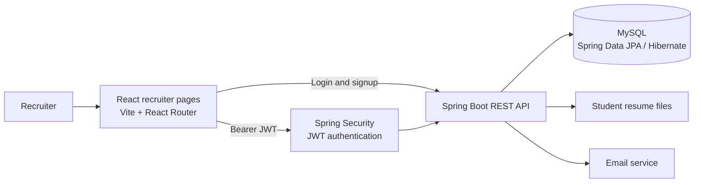
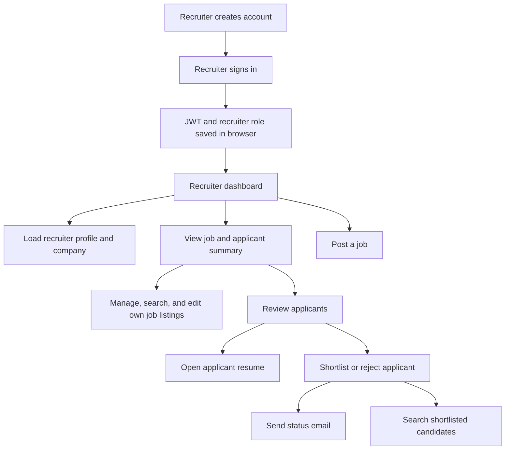
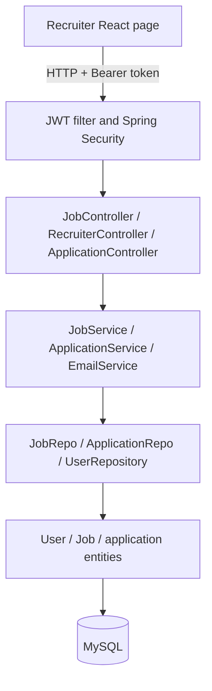
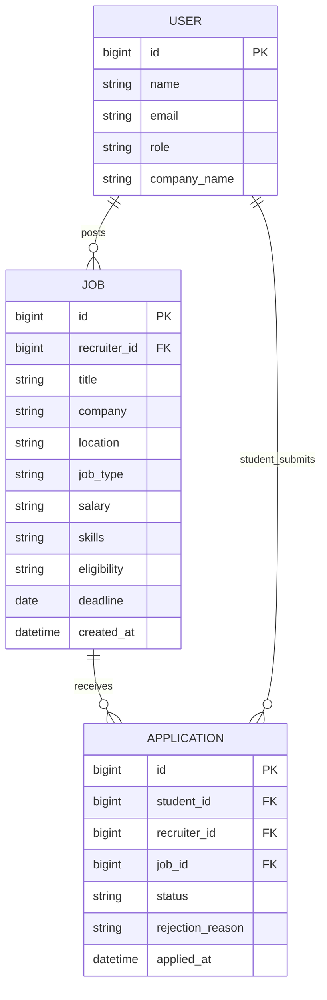

# Campus Placement Portal - Recruiter Architecture

This document covers only the recruiter-facing part of the existing Campus Placement Portal. It describes the recruiter UI, API flow, persistence, and the access-control behavior currently present in the repository.

## Recruiter system overview

The recruiter frontend is in `placement-portal/src/RecruiterAuth/`, `RecruiterDashboard/`, `Recuriter-ManageJobs/`, `RecuriterApplication/`, and `Shortlisted/`. The backend is the same Spring Boot application used by the student portal.

## Recruiter user journey

## Frontend pages and routes

| Route | Page/component | Main responsibility |
|---|---|---|
| `/recruiterAuth` | `RecruiterAuth/RecruiterAuth.jsx` | Recruiter sign in and company/recruiter registration |
| `/recruiterDashboard` | `RecruiterDashboard/RecruiterDashboard.jsx` | Profile card, hiring overview, quick actions, and post-job form |
| `/recruiter/manage-jobs` | `Recuriter-ManageJobs/ManageJobs.jsx` | Active and closed listings, application counts, job editing |
| `/jobsRecuriter/:id` | `Recuriter-ManageJobs/ViewJobsRecruiter.jsx` | Recruiter-facing job details |
| `/recruiter/applicants` | `RecuriterApplication/ViewApplicants.jsx` | Filter and review applicant records; open resumes; change applicant status |
| `/recruiter/shortlisted` | `Shortlisted/Shortlisted.jsx` | Search and review shortlisted applicants |

The shared `Student/Headers.jsx` component selects recruiter navigation based on the current path. The recruiter dashboard composes `ProfileCard`, `RecruiterOverview`, `QuickActions`, and `PostJob`.

## Backend layers and recruiter data flow

### Recruiter identity

Recruiter accounts use the `User` entity with recruiter name, email, company name, and role. Sign in uses `POST /api/auth/login`; recruiter signup uses `POST /api/auth/recruiter/signup`. The frontend verifies that the returned role is `ROLE_RECRUITER` before navigating to the recruiter dashboard. Authenticated backend requests receive a `UserPrincipal` from the JWT filter.

### Job ownership and listings

`Job` stores the posting fields and a `recruiterId`. `JobService.PostJob` sets this ID from the authenticated principal when saving a posting. Recruiter list queries use this ID to load recent, active, closed, counted, or searched postings. The `Job` entity includes title, company, location, job type, salary, description, eligibility, required skills, responsibilities, deadline, created timestamp, and recruiter ID.

### Applications and candidate review

An application stores `studentId`, `jobId`, `recruiterId`, application time, status, and optional rejection reason. The `application` entity exposes `Job` and `Student` as transient fields so the service can return joined candidate and job details without persisting those nested objects as application columns. Recruiter review screens use the recruiter-applicants and shortlisted APIs, then request the student's resume through the existing resume endpoint.

## Recruiter API map

All protected requests from the recruiter UI include `Authorization: Bearer <JWT>`.

| Method | Path | Used for |
|---|---|---|
| `POST` | `/api/auth/recruiter/signup` | Register recruiter account |
| `POST` | `/api/auth/login` | Authenticate recruiter account |
| `GET` | `/api/recruiter/profile` | Load recruiter name, email, company, and role |
| `POST` | `/api/jobs/addJob` | Create a job owned by the authenticated recruiter |
| `GET` | `/api/jobs/allJobsById` | List recruiter job postings |
| `GET` | `/api/jobs/recent` | Load recent recruiter postings |
| `GET` | `/api/jobs/allActiveJobs` | Load postings with current/future deadlines |
| `GET` | `/api/jobs/allClosedJobs` | Load postings with past deadlines |
| `GET` | `/api/jobs/search?keyword=...` | Search recruiter postings |
| `PUT` | `/api/jobs/{id}` | Update a job posting |
| `GET` | `/api/applications/recruiter/applicants` | Load applicants to recruiter postings |
| `GET` | `/api/applications/count` | Count recruiter applications |
| `GET` | `/api/applications/shortlisted/count` | Count shortlisted applicants |
| `GET` | `/api/applications/recuriter/shortlisted` | Load shortlisted applicants (existing route spelling) |
| `GET` | `/api/applications/recruiter/shortlisted/search?jobId=...&keyword=...` | Search shortlisted candidates |
| `PUT` | `/api/applications/shortlist/{id}` | Shortlist an application |
| `PUT` | `/api/applications/rejected/{id}` | Reject an application |
| `GET` | `/api/student/resume/{filename}` | View an applicant's saved resume as a recruiter |
| `POST` | `/api/email/send` | Send a recruiter email, subject to the configured email endpoint |

## Security boundaries and implementation note

Spring Security requires the recruiter role for `/api/recruiter/**`. The resume read endpoint allows both recruiter and student roles. The current security configuration requires authentication for `/api/applications/**`, but does not role-restrict that whole path to recruiters; individual application operations must perform the appropriate ownership checks.

Job creation takes the recruiter ID from the authenticated principal. Before production use, verify ownership checks on job updates and application status changes: the current `JobService.updateJob` and application status methods accept record IDs, and the corresponding handlers do not consistently verify that the requested job/application belongs to the authenticated recruiter. The recruiter UI is not a substitute for backend authorization.

## Persistence relationships

The current application entity stores IDs rather than JPA relationships to `Job`, `Student`, and `User`; the related objects exposed to recruiter screens are transient response fields populated by service logic.

## Source map

| Layer | Key files |
|---|---|
| Recruiter routes | `placement-portal/src/App.jsx` |
| Recruiter auth | `placement-portal/src/RecruiterAuth/RecruiterAuth.jsx` |
| Dashboard | `placement-portal/src/RecruiterDashboard/RecruiterDashboard.jsx`, `RecruiterOverview.jsx`, `ProfileCard.jsx`, `QuickActions.jsx` |
| Job management | `placement-portal/src/Recuriter-ManageJobs/ManageJobs.jsx`, `PostJob.jsx`, `ViewJobsRecruiter.jsx` |
| Applicant review | `placement-portal/src/RecuriterApplication/ViewApplicants.jsx` |
| Shortlist | `placement-portal/src/Shortlisted/Shortlisted.jsx`, `API/shortlistedApi.js` |
| Security | `placement-portal-bk/placement-portal-bk/src/main/java/com/telusko/placement_portal/security/SecurityConfig.java`, `JwtAuthenticationFilter.java` |
| Controllers | `RecruiterController.java`, `JobController.java`, `ApplicationController.java`, `EmailController.java` |
| Services | `JobService.java`, `ApplicationService.java`, `EmailService.java` |
| Data | `User.java`, `Job.java`, `application.java`, `JobRepo.java`, `ApplicationRepo.java` |
