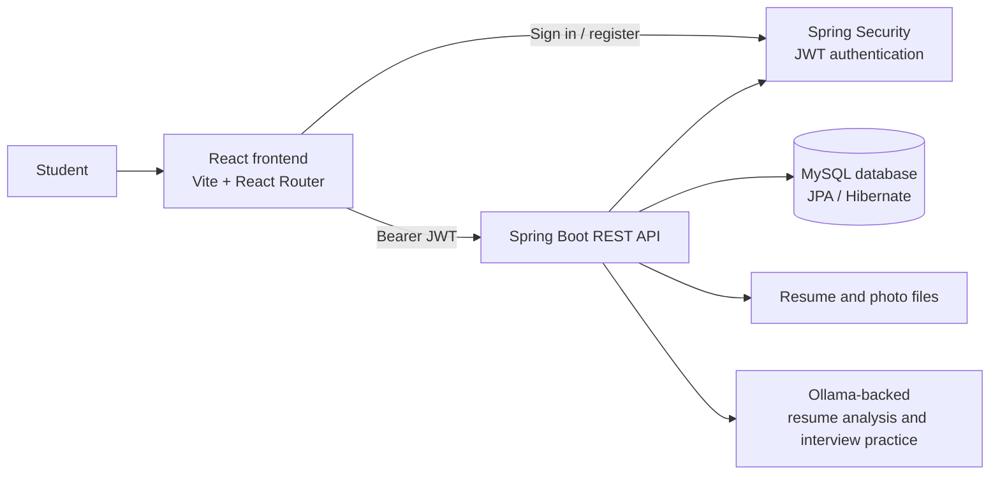
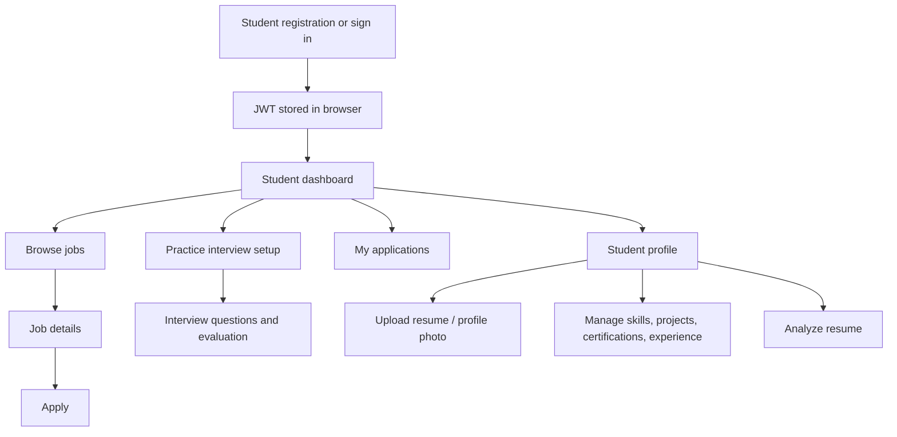
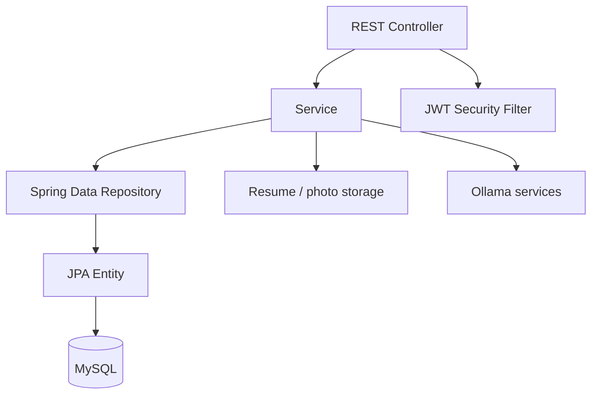

# Campus Placement Portal — Student Side Architecture

This document describes the student-facing architecture currently implemented in this project. It is written as a standalone reference that can be copied into a report or design document.

## 1. System overview

## 2. Student user journey

## 3. Frontend structure

Source root: `placement-portal/src`

| Area | Files | Responsibility |
|---|---|---|
| Routing | `App.jsx` | Connects student URLs to page components. |
| Student authentication | `StudentAuth/StudentAuth.jsx` | Student registration and sign-in; saves JWT and role, then opens `/dashboard`. |
| Student dashboard | `Student/StudentDashboard.jsx`, `Student/StudentDashBoard.css` | Profile summary, application metrics, job recommendations, preparation entry points, resume/photo actions. |
| Readiness scoring | `Student/Functions/placementReadiness.js` | Shared profile completion helper, configurable 60/20/20 scoring rules, readiness levels, skill normalization, and dynamic recommendations. |
| Student navigation | `Student/Headers.jsx`, `Student/Headers.css` | Student page navigation and sign out. |
| Profile | `Student/StudentProfile.jsx`, `Student/StudentProfile.css` | Personal and academic profile, skills, profile links, repeatable portfolio entries, visibility, resume and photo management. |
| Jobs | `Student/ViewJobs.jsx`, `Student/ViewJobs.css`, `Student/Functions/viewjobs.js` | Job search/listing and interview-practice setup. |
| Job matching | `Student/JobMatches.jsx`, `Student/JobMatches.css` | Student-scoped job matches, deterministic eligibility, match breakdowns, skill gaps, and existing application workflow. |
| Job details | `Student/JobDetails.jsx`, `Student/JobDetails.css` | Displays a selected job, current application state, and apply action. |
| Applications | `StudentApplication/Application.jsx`, `StudentApplication/Application.css` | Student’s application list and statuses. |
| Mock interview | `Student/MockInterview.jsx`, `Student/MockInterview.css` | Requests questions, captures responses, submits answers for evaluation, and shows results. |
| DSA tracker | `Student/DsaTracker.jsx`, `Student/DsaTracker.css`, `Student/Functions/dsaOptions.js` | Student-owned CRUD tracker, filters, topic progress, difficulty distribution, recent activity, and DSA benchmark progress. |

### Student routes

| Route | Page |
|---|---|
| `/studentAuth` | Student sign-in and registration |
| `/dashboard` | Student home dashboard |
| `/profile` | Student profile and resume management |
| `/viewjobs` | Browse jobs and open mock-interview setup |
| `/job-matches` | Personalized matches, eligibility, and skill gaps |
| `/jobs/:id` | Job details and application action |
| `/application` | Student’s applications |
| `/mock-interview` | Interview practice session |
| `/dsa-tracker` | Persisted DSA and coding problem tracker |

## 4. Backend architecture

The backend is Spring Boot, using Spring Security with JWT, controller/service/repository layers, Spring Data JPA, and MySQL. Student endpoints are under `/api/student`; the authenticated student identity is taken from the JWT principal for profile operations and profile-entry ownership.

## 5. Student API map

All authenticated calls send `Authorization: Bearer <JWT>` unless otherwise noted.

| API | Purpose |
|---|---|
| `POST /api/auth/signup` | Register an account. |
| `POST /api/auth/login` | Authenticate and receive the JWT and role. |
| `GET /api/student/profile` | Get the signed-in student’s profile; creates a starter profile when one does not yet exist. |
| `POST /api/student/profile` | Save the signed-in student’s profile fields. |
| `POST /api/student/photo` | Upload the profile photo. |
| `GET /api/student/photo/{filename}` | Load a profile photo; photo reads are configured as public. |
| `POST /api/student/resume` | Upload the student’s PDF resume. |
| `GET /api/student/resume/{filename}` | Retrieve an uploaded resume; security allows student and recruiter roles. |
| `GET /api/student/profile/entries` | List the signed-in student’s projects, certifications, and experience entries. |
| `POST /api/student/profile/entries` | Add a portfolio entry. |
| `PUT /api/student/profile/entries/{id}` | Update an owned portfolio entry. |
| `DELETE /api/student/profile/entries/{id}` | Delete an owned portfolio entry. |
| `GET /api/jobs/allJobs` | Load job listings for the dashboard and jobs page. |
| `GET /api/jobs/{id}` | Load job details. |
| `GET /api/applications/student/{studentId}` | Load applications for the signed-in student; controller checks the JWT student ID. |
| `GET /api/applications/student/{studentId}/job/{jobId}` | Check whether the signed-in student already applied to a job. |
| `POST /api/applications/applied` | Submit an application; controller checks that the application belongs to the JWT student. |
| `GET /api/applications/getStatus/{id}` | Read application status. |
| `POST /api/resume-analyzer/analyze` | Analyze an uploaded resume using the existing AI integration. This returns analysis text; it does not save a score/history. |
| `POST /api/mock-interview/questions` | Generate practice questions. |
| `POST /api/mock-interview/submit` | Evaluate the submitted practice answers. |
| `GET /api/student/dsa/problems` | List only the authenticated student’s DSA records. |
| `POST /api/student/dsa/problems` | Add an owned problem record; duplicate logical problems return HTTP 409. |
| `GET /api/student/dsa/problems/{id}` | Read a problem only when it belongs to the authenticated student. |
| `PUT /api/student/dsa/problems/{id}` | Update an owned problem record. |
| `DELETE /api/student/dsa/problems/{id}` | Delete an owned problem record. |
| `GET /api/student/dsa/stats` | Compute tracker counts, topic/difficulty breakdowns, and DSA readiness from stored rows. |

## 6. Data ownership and persistence

- The `Student` record is keyed to the authenticated user ID. The frontend does not choose the profile owner when reading or saving the profile.
- Student profile entries are related to a student and are queried or changed only within that student’s ownership scope.
- Applications are loaded and created with the authenticated student identity checked by the controller.
- Resume and photo files are stored by the existing backend upload flow; the student row stores the uploaded filename.
- The student profile includes personal/academic fields, skills, profile links, uploaded file names, and profile visibility.
- Projects, certifications, and experience use the `StudentProfileEntry` entity, with an entry type distinguishing the section.
- DSA activity uses `DsaProblem`, related to `Student` by a required foreign key. Ownership is derived from `UserPrincipal`; no student ID is accepted in the DSA request body or URL.
- DSA duplicates are prevented by a per-student unique deduplication key: normalized URL when supplied, otherwise platform plus normalized problem title.

## 7. Dashboard metric sources

| Dashboard value | Source / rule |
|---|---|
| Profile completion | Count of populated profile fields used by the dashboard. |
| Applications | Signed-in student’s application records. |
| Shortlisted / rejected | Application status values from those records. |
| Eligible jobs | Active jobs whose explicit eligibility criteria pass in the backend matching service. Unparsed criteria or missing student data produce `NEEDS_REVIEW`. |
| Matching jobs | Backend match score across job-listed skills, branch, and CGPA requirements; unspecified components are omitted and remaining weights normalized. |
| Placement readiness | Shared frontend score engine. With only profile/resume/skills active it normalizes the original 60:20:20 ratio. With DSA stats loaded, the base factors share 80% (preserving 60:20:20 within that share) and DSA contributes 20%. Missing future modules are excluded from the active denominator. |
| DSA progress | Unique solved problems ÷ configurable 150-problem benchmark, capped at 100%; computed from the student’s database records. |
| DSA readiness component | 70% × benchmark progress + 30% × share of the configured topic catalog with at least one solved problem. Zero solved gives DSA score zero. |
| Resume score | Not available as a saved metric. AI analysis currently returns text and is not stored as a score. |
| Upcoming interviews | Not available; the backend does not yet expose a student interview schedule API. |
| DSA / aptitude progress | DSA is persisted in the DSA tracker; aptitude sessions and answered questions are persisted in MySQL and summarized from completed attempts. |

## 8. Authentication and request flow

1. The student submits credentials to `/api/auth/login` or registers using `/api/auth/signup`.
2. The frontend stores the returned JWT and role in browser local storage.
3. Student components attach the JWT as a Bearer token to protected API calls.
4. The JWT security filter resolves the user principal and role.
5. Spring Security restricts `/api/student/**` and `/api/mock-interview/**` to students; student-owned controller methods use the principal to scope records.
6. Sign out removes the stored token and role, then returns the user to the portal landing page.

## 9. Current feature boundaries

The student side supports profile management, portfolio entries, resume and photo uploads, job browsing, job applications, resume analysis, AI interview practice, a persisted DSA tracker, and persisted aptitude practice and timed tests. Interview attempt history, interview scheduling, resume analysis scores/history, and training attendance are still unavailable. The readiness engine excludes modules until actual data is implemented.

## 10. Aptitude practice and assessment

- Tables: `aptitude_questions` stores the seeded aptitude bank; `aptitude_attempts` stores student-owned practice/test sessions and server-calculated summaries; `aptitude_attempt_questions` stores each session's question order, shuffled option mapping, answer, and review marker.
- The initial bank seeds one question for each of the 34 supported topics once, when the question table is empty. New questions can be added to the database without a frontend change.
- Student API routes under `/api/student/aptitude/**` use the existing `ROLE_STUDENT` security rule. Ownership always comes from `UserPrincipal`; client-supplied student IDs are not accepted.
- Questions sent before submission omit correct answers and explanations. The randomized option mapping is saved per attempt so refreshes do not change option meanings. Practice reveals feedback after an answer is saved; timed tests reveal the answer key only after submission.
- Timed deadlines are checked by the server on answer/session requests and by a 30-second scheduled expiry task. Answers are persisted as they change, allowing active sessions to resume after a refresh.
- Score is correct answers divided by total questions. Accuracy is correct answers divided by answered questions. Weak topics require at least 5 saved answers and below 60% accuracy; strong topics require at least 5 and at least 80% accuracy.
- Aptitude readiness uses all completed attempt answers: 60% overall accuracy, 20% topic coverage across the 34-topic catalog, and 20% consistency. With fewer than two completed attempts, accuracy stands in for consistency. Aptitude joins the shared readiness engine as a 12-weight active factor and all active factors normalize to 100; no attempt means the factor is excluded.
- APIs: `GET /catalog`, `GET /analytics`, `GET /history`, `GET /sessions/active`, `POST /sessions`, `GET /sessions/{id}`, `PUT /sessions/{id}/answers/{questionId}`, `POST /sessions/{id}/submit`, and `GET /attempts/{id}`.

## 11. Smart job matches

- `/api/student/job-matches/**` derives the student from `UserPrincipal`; it does not accept a student ID. Matches are computed from the current `Student`, `Job`, and application rows on each request, so saved profile or recruiter job edits do not leave stale scores.
- Match formula: required skill coverage 60%, branch match 20%, and minimum CGPA match 20%. Only criteria present in that job are included; remaining weights are normalized. Skills do not cause hard ineligibility because the current job model has no mandatory-skill flag.
- Eligibility is separate: a confirmed hard failure yields `NOT_ELIGIBLE`; missing required profile data or unparsed free-text criteria yields `NEEDS_REVIEW`; otherwise parsed criteria yield `ELIGIBLE`. Skills alone do not determine eligibility.
- Jobs past their deadline are excluded from active recommendations. The current `Job` model has no independent active flag or preferred-skills field, so neither is fabricated. Unrecognized free-text eligibility must be reviewed.
- Application submission reuses `/api/applications/applied`, checks the authenticated student, rejects expired jobs and confirmed eligibility failures, prevents duplicates through the existing application service, and derives recruiter ownership from the saved job.
- APIs: `GET /summary`, `GET /jobs?filter=ALL|ELIGIBLE|HIGH_MATCH|MISSING_SKILLS|APPLIED`, `GET /eligible`, `GET /high-match`, `GET /skill-gaps`, and `GET /{jobId}`.
